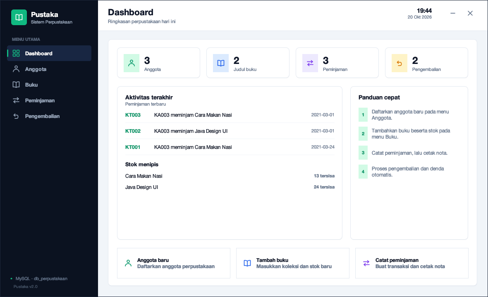
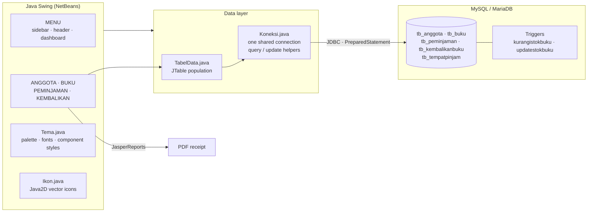
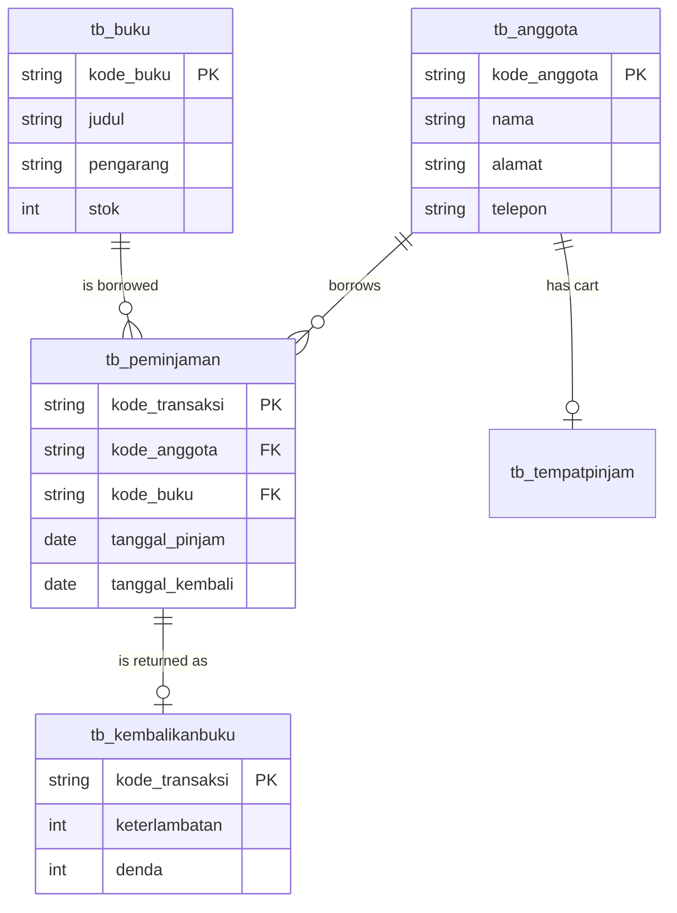
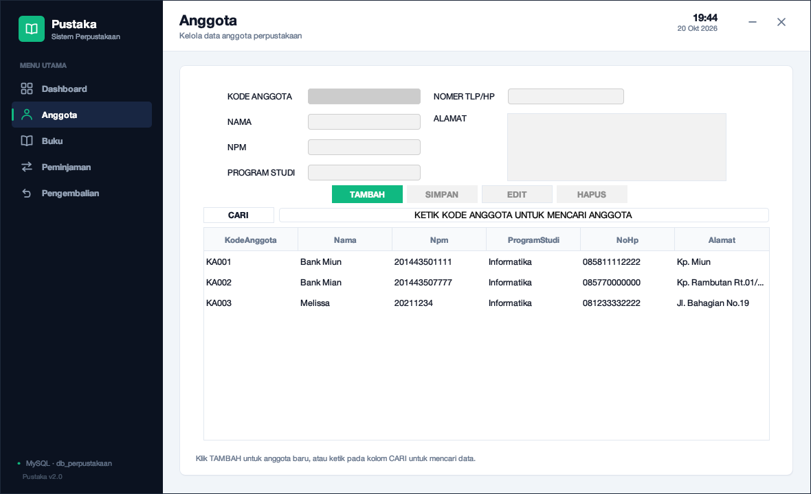
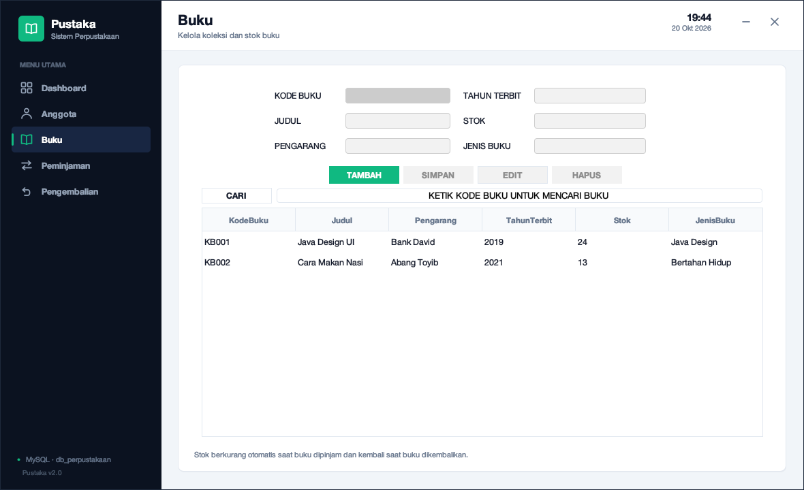
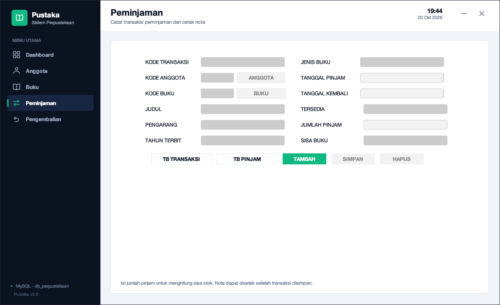
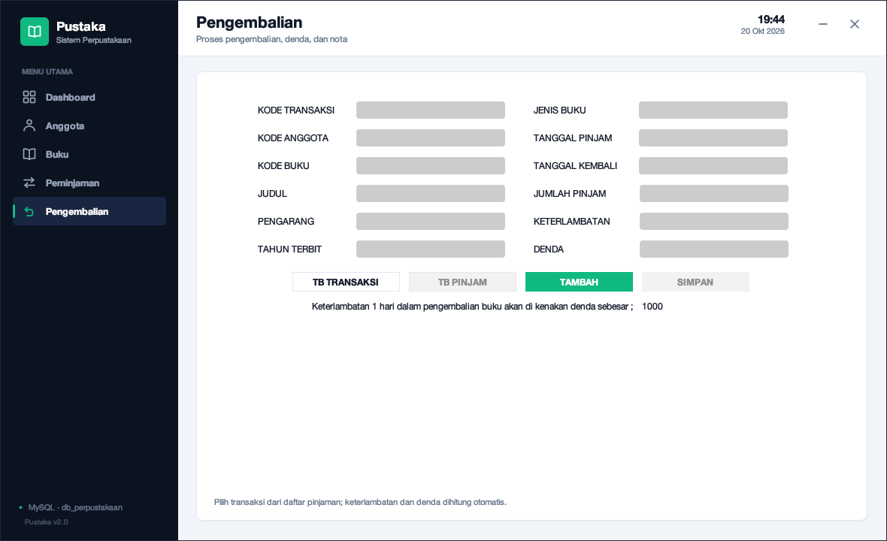
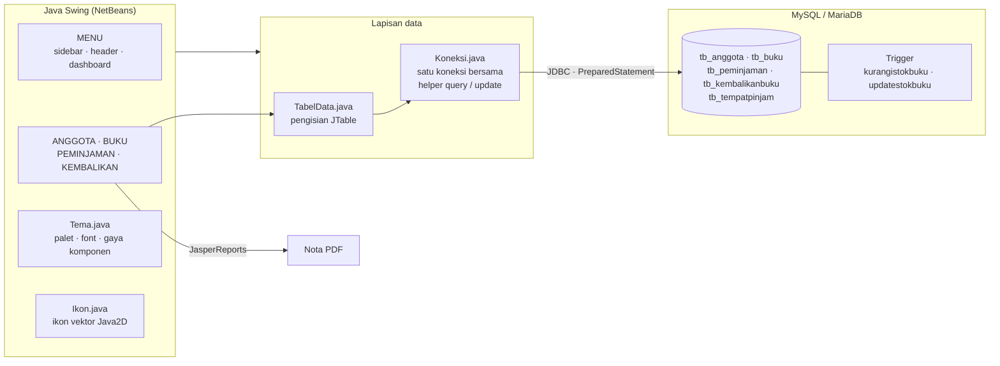
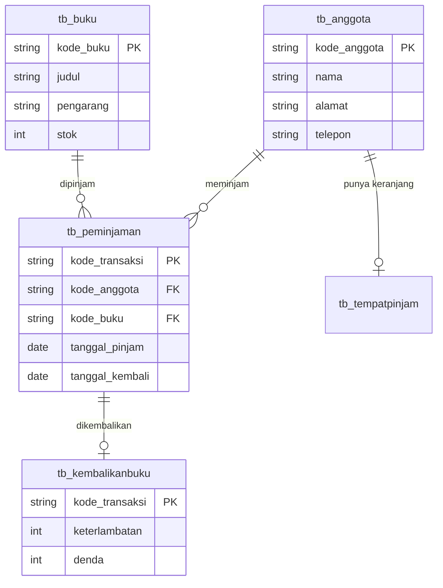

<div align="center">

**🌐 [🇬🇧 English](#english-version) · [🇮🇩 Bahasa Indonesia](#versi-bahasa-indonesia)**

</div>

---

# Pustaka — Library Management (Java Swing)

**A desktop library system that a school admin can actually use: members, stock, loans, returns, fines and printed receipts — no browser, no cloud, no monthly fee.**

[](https://adoptium.net/)
[](https://docs.oracle.com/javase/tutorial/uiswing/)
[](https://www.formdev.com/flatlaf/)
[](https://mariadb.org/)
[](https://community.jaspersoft.com/)
[](https://ant.apache.org/)
[](#license)

</div>

<p align="center">
  
  <br>
  <em>The dashboard: live counts, recent loans, low-stock warnings and the quick actions.</em>
</p>

<!-- 📸 DROP-IN SLOT — a 10-second GIF of "add member → add book → loan → return → print
     receipt" belongs right below the dashboard. That single flow explains the whole app. -->

## Table of contents

- [Why this exists](#why-this-exists)
- [Features](#features)
- [How it works](#how-it-works)
- [Tech stack](#tech-stack)
- [Database](#database)
- [Getting started](#getting-started)
- [Configuration](#configuration)
- [Usage](#usage)
- [Screenshots](#screenshots)
- [Project structure](#project-structure)
- [Technical notes](#technical-notes)
- [Roadmap](#roadmap)
- [License](#license)

---

## English Version

### Why this exists

This started as a Java desktop assignment: build a CRUD app. The assignment version
worked, and looked like every other NetBeans CRUD app — grey panels, default fonts, a
`JTable` with grid lines. It would have been fine to submit.

I kept going because of one question: **what would it take for the librarian to prefer
this over a notebook?** That question changed the scope. Stock can't be a number the
operator remembers to edit, so the database now decrements it with a trigger. A loan
receipt isn't optional in a school library, so JasperReports prints it. Typing a member
code at the counter is slow, so the loan form has a search dialog. And the UI got a real
design system instead of the NetBeans defaults.

The result is a small app that behaves like software rather than a submission: prepared
statements everywhere, centralised connection handling, auto-generated codes, and a
database that protects its own invariants.

> [!NOTE]
> This is a **desktop** app, deliberately. A school library with one counter does not need
> a server, a login server, or a monthly bill. MySQL on the office PC is enough.

### Features

| Module | What it does |
|--------|--------------|
| 📊 **Dashboard** | Member / book / transaction counts, latest loans, low-stock alerts, quick actions |
| 👥 **Members** | Create, edit, delete, search by code or name |
| 📚 **Books** | Create, edit, delete, search by code or title, manage stock |
| 📤 **Loans** | Pick member + book through search dialogs, auto stock check, save, print receipt |
| 📥 **Returns** | Load an open loan, compute days late and the fine, print receipt, restore stock |
| 🧾 **Reports** | Loan and return receipts as PDF via JasperReports |
| 🎨 **Theme** | FlatLaf 3.4 + a small design system (`Tema.java`) + vector icons (`Ikon.java`) |

Details that are handled on purpose:

- Member, book and transaction codes are generated automatically (`KA001`, `KB001`, `KT001`).
- Empty fields are validated before saving; deletes ask for confirmation.
- Stock is decremented on loan and restored on return by **database triggers**, not by UI code.
- Every query uses **`PreparedStatement`** with bound parameters — no string concatenation.
- The connection string is configurable without touching source code.

### How it works



The stock invariant is the clearest example of the design: the UI never writes `stok`.
It inserts a row into `tb_tempatpinjam` (the loan cart) and the `kurangistokbuku` trigger
decrements `tb_buku`; inserting into `tb_kembalikanbuku` fires `updatestokbuku`. Even if a
future screen forgets to handle stock, the database does not.

### Tech stack

| Layer | Choice | Why |
|-------|--------|-----|
| Language | **Java 8** | The assignment target, and still the safest JDK for old lab machines |
| UI | **Java Swing** | No runtime install beyond the JRE; mature `JTable` and layout support |
| Theme | **FlatLaf 3.4** | Modern flat look without rebuilding every component |
| Design system | **`Tema.java` + `Ikon.java`** | One palette, one icon language, Retina-sharp vector icons |
| Database | **MySQL 5.7+ / MariaDB 10.3+** | Triggers, transactions, ubiquitous in school labs |
| Driver | **MySQL Connector/J 8.4** | Current JDBC driver |
| Reports | **JasperReports 6.0** | `.jrxml` → `.jasper` → PDF, loaded from the classpath |
| Date input | **JCalendar 1.4** | A real date picker instead of a text field |
| Build | **Ant + NetBeans** | Matches the project format the course expects |

### Database

Database name: `db_perpustakaan`



| Table | Purpose |
|-------|---------|
| `tb_anggota` | Library members |
| `tb_buku` | Books and stock |
| `tb_tempatpinjam` | Temporary loan cart (one row per member) |
| `tb_peminjaman` | Loan history |
| `tb_kembalikanbuku` | Return history, days late, fine |

Triggers:

- `kurangistokbuku` — `AFTER INSERT` on `tb_tempatpinjam`, decrements `tb_buku.stok`.
- `updatestokbuku` — `AFTER INSERT` on `tb_kembalikanbuku`, restores `tb_buku.stok`.

### Getting started

**Requirements**

- JDK 8 or newer ([Adoptium Temurin](https://adoptium.net/))
- NetBeans IDE (8.2 or current)
- XAMPP, MySQL or MariaDB running locally

```bash
# 1. Clone
git clone https://github.com/glen1599/aplikasi-perpustakaan-java.git
cd aplikasi-perpustakaan-java

# 2. Import the schema (creates db_perpustakaan, tables, triggers, sample data)
mysql -u root -p < database/perpustakaan.sql
```

Or in phpMyAdmin: **Import** → `database/perpustakaan.sql` → **Go**.

**Open in NetBeans**

1. **File → Open Project** → select `PROJECTAPP_PERPUSTAKAAN`.
2. Every library ships in `lib/` (FlatLaf, JasperReports, Connector/J, JCalendar).
3. **Run Project** (F6). Main class: `projectapp_perpustakaan.MENU`.

**Build from the terminal (optional)**

```bash
cd PROJECTAPP_PERPUSTAKAAN
ant clean jar
java -jar dist/PROJECTAPP_PERPUSTAKAAN.jar
```

> [!TIP]
> The `.jar` is not a fat jar. If `java -jar` complains about missing classes, run it with
> the libs on the classpath: `java -cp "dist/PROJECTAPP_PERPUSTAKAAN.jar:lib/*"
> projectapp_perpustakaan.MENU`.

### Configuration

All connection settings live in one file: `src/projectapp_perpustakaan/Koneksi.java`.

```java
private static final String URL = System.getProperty(
        "db.url", "jdbc:mysql://localhost:3306/db_perpustakaan?...");
private static final String USER = System.getProperty("db.user", "root");
private static final String PASSWORD = System.getProperty("db.password", "");
```

Defaults match XAMPP (`root`, empty password). If your MySQL has a password, either:

**a. Change the default** in `Koneksi.java`, or

**b. Override with JVM properties** — in NetBeans:
**Run → Set Project Configuration → Customize → VM Options**:

```text
-Ddb.user=root -Ddb.password=your_password
```

> [!IMPORTANT]
> Option **b** keeps credentials out of the repository. If you ever put a real password in
> source, treat it as leaked: change it, then use the JVM property.

### Usage

1. Open **Members** and add at least one member.
2. Open **Books** and add a title with its stock.
3. **Loans**: click **ADD**, search for the member and the book, set the quantity, **SAVE**.
   The receipt can be printed immediately.
4. **Returns**: click **ADD**, open the loan list, pick the row. Days late and the fine are
   computed automatically; save and print the receipt.

### Screenshots

| Dashboard | Members |
| --- | --- |
|  |  |

| Books | Loans |
| --- | --- |
|  |  |

| Returns |
| --- |
|  |

### Project structure

```text
aplikasi-perpustakaan-java/
├── database/
│   └── perpustakaan.sql              # schema + triggers + sample rows
├── docs/
│   ├── CATATAN-INSTALASI-ASLI.txt    # original system notes
│   └── screenshots/
├── PROJECTAPP_PERPUSTAKAAN/          # NetBeans project
│   ├── build.xml
│   ├── lib/                          # FlatLaf, JasperReports, Connector/J, JCalendar
│   ├── nbproject/
│   └── src/
│       ├── projectapp_perpustakaan/
│       │   ├── MENU.java             # shell: sidebar, header, dashboard
│       │   ├── Tema.java             # palette, fonts, component styling
│       │   ├── Ikon.java             # Java2D vector icons
│       │   ├── Koneksi.java          # connection + PreparedStatement helpers
│       │   ├── TabelData.java        # JTable population
│       │   ├── ANGGOTA.java
│       │   ├── BUKU.java
│       │   ├── PEMINJAMAN.java
│       │   └── KEMBALIKAN_BUKU.java
│       ├── ICON/
│       └── REPORT/                   # .jrxml + compiled .jasper
└── README.md
```

### Technical notes

- **`MENU` is hand-written** (no GUI Builder) so the sidebar, header and dashboard could be
  designed freely. The CRUD forms still use the NetBeans Form Editor, so their
  `initComponents()` blocks must not be edited by hand.
- One shared connection (`Koneksi.getConnection()`) instead of opening a new one per query.
- All queries go through bound `PreparedStatement` parameters (`Koneksi.query/update`);
  table filling is centralised in `TabelData`.
- `.jasper` reports load from the classpath (`/REPORT/...`), so they are found even when the
  app runs from another directory.
- **Suggested next step:** split a DAO layer, add staff authentication, and add foreign
  keys between the transaction tables.

> [!WARNING]
> There is **no authentication**. Anyone who can open the app can edit records. That is
> acceptable for a single-counter school deployment on a trusted machine; it is not
> acceptable on a shared or networked PC.

### Roadmap

- [ ] Staff login with hashed passwords
- [ ] DAO layer + foreign keys on transaction tables
- [ ] Barcode scanning for member and book codes
- [ ] Export monthly loan reports to Excel
- [ ] Packaged installer with a bundled JRE (`jpackage`)

### License

Built for coursework and as a learning portfolio. Use it as a reference — attribution is
appreciated, no warranty is provided.

---

## Versi Bahasa Indonesia

**Aplikasi desktop pengelola perpustakaan yang benar-benar bisa dipakai petugas: anggota, stok, peminjaman, pengembalian, denda, dan cetak nota — tanpa browser, tanpa cloud, tanpa biaya bulanan.**

### Kenapa proyek ini ada

Awalnya ini tugas kuliah Java desktop: bikin aplikasi CRUD. Versi tugasnya jalan, dan
tampilannya sama seperti aplikasi CRUD NetBeans lain — panel abu-abu, font default,
`JTable` bergaris kisi. Kalau hanya untuk dikumpulkan, itu sudah cukup.

Saya lanjut karena satu pertanyaan: **apa yang membuat petugas perpustakaan lebih memilih
aplikasi ini daripada buku catatan?** Pertanyaan itu mengubah cakupannya. Stok tidak boleh
jadi angka yang harus diingat untuk diedit, jadi sekarang database yang menguranginya lewat
trigger. Nota peminjaman bukan opsional di perpustakaan sekolah, jadi JasperReports yang
mencetaknya. Mengetik kode anggota di meja layanan lambat, jadi form peminjaman punya dialog
pencarian. Dan tampilannya mendapat sistem desain sungguhan, bukan default NetBeans.

Hasilnya aplikasi kecil yang berperilaku seperti software, bukan seperti tugas: prepared
statement di semua query, koneksi terpusat, kode otomatis, dan database yang menjaga
invariant-nya sendiri.

> [!NOTE]
> Ini aplikasi **desktop**, dan itu disengaja. Perpustakaan sekolah dengan satu meja
> layanan tidak butuh server, login server, atau tagihan bulanan. MySQL di PC kantor sudah
> cukup.

### Fitur utama

| Modul | Kemampuan |
|-------|-----------|
| 📊 **Dashboard** | Statistik anggota/buku/transaksi, aktivitas peminjaman terakhir, peringatan stok menipis, aksi cepat |
| 👥 **Data Anggota** | Tambah, ubah, hapus, pencarian berdasarkan kode atau nama |
| 📚 **Data Buku** | Tambah, ubah, hapus, pencarian berdasarkan kode atau judul, pengelolaan stok |
| 📤 **Peminjaman** | Pilih anggota dan buku lewat dialog pencarian, cek stok otomatis, simpan, cetak nota |
| 📥 **Pengembalian** | Ambil data pinjaman, hitung keterlambatan dan denda, cetak nota, stok kembali bertambah |
| 🧾 **Laporan** | Nota peminjaman dan pengembalian dalam format PDF via JasperReports |
| 🎨 **Tema** | FlatLaf 3.4 + sistem desain kecil (`Tema.java`) + ikon vektor (`Ikon.java`) |

Detail yang sengaja ditangani:

- Kode anggota, buku, dan transaksi dibuat otomatis (`KA001`, `KB001`, `KT001`).
- Input kosong divalidasi sebelum menyimpan; hapus data selalu minta konfirmasi.
- Stok berkurang saat dipinjam dan bertambah saat dikembalikan lewat **trigger database**,
  bukan lewat kode UI.
- Semua query memakai **`PreparedStatement`** dengan parameter terikat — tanpa penyambungan string.
- Koneksi database bisa dikonfigurasi tanpa mengubah kode sumber.

### Cara kerja



Invariant stok adalah contoh paling jelas dari desainnya: UI tidak pernah menulis `stok`.
Ia menyisipkan baris ke `tb_tempatpinjam` (keranjang pinjam), lalu trigger
`kurangistokbuku` mengurangi `tb_buku`; penyisipan ke `tb_kembalikanbuku` memicu
`updatestokbuku`. Kalaupun suatu saat ada layar baru yang lupa menangani stok, database
tetap benar.

### Tech stack

| Lapisan | Pilihan | Alasan |
|---------|---------|--------|
| Bahasa | **Java 8** | Target tugas, dan JDK paling aman untuk komputer lab lama |
| UI | **Java Swing** | Tanpa instalasi tambahan selain JRE; `JTable` dan layout sudah matang |
| Tema | **FlatLaf 3.4** | Tampilan flat modern tanpa membangun ulang setiap komponen |
| Sistem desain | **`Tema.java` + `Ikon.java`** | Satu palet, satu bahasa ikon, ikon vektor tetap tajam di Retina |
| Database | **MySQL 5.7+ / MariaDB 10.3+** | Trigger, transaksi, dan tersedia luas di lab sekolah |
| Driver | **MySQL Connector/J 8.4** | Driver JDBC terkini |
| Laporan | **JasperReports 6.0** | `.jrxml` → `.jasper` → PDF, dimuat dari classpath |
| Input tanggal | **JCalendar 1.4** | Date picker sungguhan, bukan text field |
| Build | **Ant + NetBeans** | Sesuai format proyek yang diminta mata kuliah |

### Database

Nama database: `db_perpustakaan`



| Tabel | Fungsi |
|-------|--------|
| `tb_anggota` | Data anggota perpustakaan |
| `tb_buku` | Data buku dan stok |
| `tb_tempatpinjam` | Keranjang pinjam sementara (satu baris per anggota) |
| `tb_peminjaman` | Riwayat transaksi peminjaman |
| `tb_kembalikanbuku` | Riwayat pengembalian, keterlambatan, dan denda |

Trigger:

- `kurangistokbuku` — `AFTER INSERT` pada `tb_tempatpinjam`, mengurangi `tb_buku.stok`.
- `updatestokbuku` — `AFTER INSERT` pada `tb_kembalikanbuku`, menambah `tb_buku.stok`.

### Instalasi

**Prasyarat**

- JDK 8 atau lebih baru ([Adoptium Temurin](https://adoptium.net/))
- NetBeans IDE (8.2 atau versi terbaru)
- XAMPP, MySQL, atau MariaDB yang sudah berjalan

```bash
# 1. Clone
git clone https://github.com/glen1599/aplikasi-perpustakaan-java.git
cd aplikasi-perpustakaan-java

# 2. Import skema (membuat db_perpustakaan, tabel, trigger, data contoh)
mysql -u root -p < database/perpustakaan.sql
```

Atau lewat phpMyAdmin: **Import** → `database/perpustakaan.sql` → **Go**.

**Buka di NetBeans**

1. **File → Open Project** → pilih `PROJECTAPP_PERPUSTAKAAN`.
2. Semua library sudah ada di `lib/` (FlatLaf, JasperReports, Connector/J, JCalendar).
3. **Run Project** (F6). Kelas utama: `projectapp_perpustakaan.MENU`.

**Build lewat terminal (opsional)**

```bash
cd PROJECTAPP_PERPUSTAKAAN
ant clean jar
java -jar dist/PROJECTAPP_PERPUSTAKAAN.jar
```

> [!TIP]
> Jar-nya bukan fat jar. Kalau `java -jar` mengeluh kelas tidak ditemukan, jalankan dengan
> library di classpath: `java -cp "dist/PROJECTAPP_PERPUSTAKAAN.jar:lib/*"
> projectapp_perpustakaan.MENU`.

### Konfigurasi

Semua pengaturan koneksi ada di satu tempat: `src/projectapp_perpustakaan/Koneksi.java`.

```java
private static final String URL = System.getProperty(
        "db.url", "jdbc:mysql://localhost:3306/db_perpustakaan?...");
private static final String USER = System.getProperty("db.user", "root");
private static final String PASSWORD = System.getProperty("db.password", "");
```

Default cocok untuk XAMPP (`root`, tanpa password). Kalau MySQL Anda memakai password,
pilih salah satu:

**a. Ubah nilai default** di `Koneksi.java`, atau

**b. Timpa lewat JVM property** — di NetBeans:
**Run → Set Project Configuration → Customize → VM Options**:

```text
-Ddb.user=root -Ddb.password=password_anda
```

> [!IMPORTANT]
> Opsi **b** menjaga kredensial tetap di luar repository. Kalau password asli sempat masuk
> ke kode sumber, anggap sudah bocor: ganti password-nya, lalu pakai JVM property.

### Cara menggunakan

1. Buka menu **Anggota** dan isi minimal satu anggota.
2. Buka menu **Buku** dan tambahkan koleksi beserta stok.
3. Menu **Peminjaman**: klik **TAMBAH**, cari anggota dan buku lewat tombol pencarian, isi
   jumlah pinjam, lalu **SIMPAN**. Nota bisa langsung dicetak.
4. Menu **Pengembalian**: klik **TAMBAH**, buka daftar pinjaman, pilih baris transaksi.
   Keterlambatan dan denda dihitung otomatis, lalu simpan dan cetak nota.

### Screenshot

| Dashboard | Data Anggota |
| --- | --- |
|  |  |

| Data Buku | Peminjaman |
| --- | --- |
|  |  |

| Pengembalian |
| --- |
|  |

### Struktur proyek

```text
aplikasi-perpustakaan-java/
├── database/
│   └── perpustakaan.sql              # skema + trigger + data contoh
├── docs/
│   ├── CATATAN-INSTALASI-ASLI.txt    # catatan sistem dari paket asli
│   └── screenshots/
├── PROJECTAPP_PERPUSTAKAAN/          # proyek NetBeans
│   ├── build.xml
│   ├── lib/                          # FlatLaf, JasperReports, Connector/J, JCalendar
│   ├── nbproject/
│   └── src/
│       ├── projectapp_perpustakaan/
│       │   ├── MENU.java             # shell: sidebar, header, dashboard
│       │   ├── Tema.java             # palet, font, gaya komponen
│       │   ├── Ikon.java             # ikon vektor Java2D
│       │   ├── Koneksi.java          # koneksi + helper PreparedStatement
│       │   ├── TabelData.java        # pengisian JTable
│       │   ├── ANGGOTA.java
│       │   ├── BUKU.java
│       │   ├── PEMINJAMAN.java
│       │   └── KEMBALIKAN_BUKU.java
│       ├── ICON/
│       └── REPORT/                   # .jrxml + .jasper hasil kompilasi
└── README.md
```

### Catatan teknis

- **`MENU` ditulis manual** (tanpa GUI Builder) agar sidebar, header, dan dashboard bisa
  dirancang bebas. Form CRUD lainnya tetap memakai NetBeans Form Editor, jadi blok
  `initComponents()` tidak boleh diubah sembarangan.
- Koneksi database memakai satu instance bersama (`Koneksi.getConnection()`) agar tidak
  membuka koneksi baru di setiap query.
- Semua query lewat `PreparedStatement` dengan parameter terikat (`Koneksi.query/update`);
  pengisian tabel dipusatkan di `TabelData`.
- Laporan `.jasper` dimuat dari classpath (`/REPORT/...`), jadi tetap ditemukan meskipun
  aplikasi dijalankan dari folder lain.
- **Pengembangan lanjutan yang disarankan:** pisahkan lapisan DAO, tambahkan autentikasi
  petugas, dan tambahkan foreign key antar tabel transaksi.

> [!WARNING]
> Tidak ada **autentikasi**. Siapa pun yang bisa membuka aplikasi bisa mengubah data. Itu
> wajar untuk perpustakaan satu meja di komputer tepercaya; tidak wajar di PC bersama atau
> jaringan.

### Rencana ke depan

- [ ] Login petugas dengan password ter-hash
- [ ] Lapisan DAO + foreign key pada tabel transaksi
- [ ] Scan barcode untuk kode anggota dan buku
- [ ] Ekspor laporan peminjaman bulanan ke Excel
- [ ] Installer dengan JRE bawaan (`jpackage`)

### Lisensi

Dibuat untuk keperluan pembelajaran dan portofolio. Silakan dipakai sebagai referensi —
atribusi dihargai, tanpa jaminan apa pun.

---

<div align="center">

<sub>Dibangun dengan Java Swing, satu meja layanan, dan keyakinan bahwa database harus menjaga dirinya sendiri.</sub>

</div>
